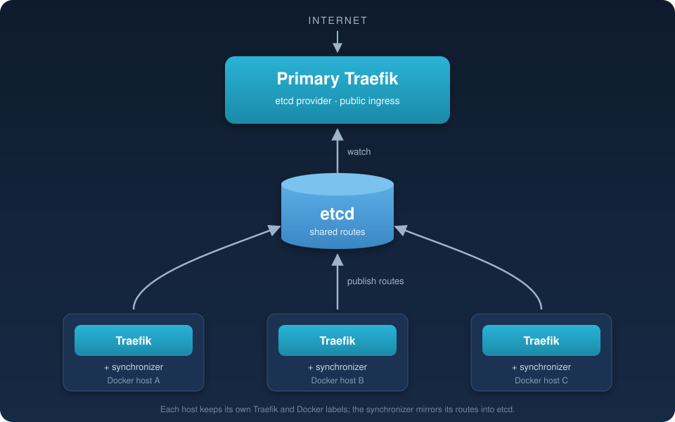

<h1 align="center">Traefik Multi-Host Route Synchronizer</h1>

<p align="center">
  <a href="https://github.com/deepakavanthi/traefik-synchronizer/actions/workflows/main.yml"></a>
  <a href="https://github.com/deepakavanthi/traefik-synchronizer/pkgs/container/traefik-synchronizer"></a>
  
  
</p>

<p align="center">
  
</p>

## Download

Pre-built images are published to the GitHub Container Registry on every push to `main`:

```bash
docker pull ghcr.io/deepakavanthi/traefik-synchronizer:latest
```

Each build is also tagged with its workflow run number. See all versions on the [package page](https://github.com/deepakavanthi/traefik-synchronizer/pkgs/container/traefik-synchronizer).

## Overview

A small containerized agent that runs alongside Traefik on each Docker host, discovers the routes configured by that host's local Traefik instance, and publishes corresponding dynamic configuration to a shared etcd cluster.

A central Traefik instance can then use the etcd provider as its source of dynamic configuration and act as the primary ingress for multiple Docker hosts.

> **Status:** This is a lightweight starting point, not a hardened production controller. Review the security, lifecycle, and feature limitations below before exposing it to production traffic.

## Table of contents

- [Download](#download)
- [Concept](#concept)
- [How it works](#how-it-works)
- [Architecture](#architecture)
- [Requirements](#requirements)
- [Quick start](#quick-start)
- [Configuration](#configuration)
- [HTTP and HTTPS upstreams](#http-and-https-upstreams)
- [TCP routing](#tcp-routing)
- [Primary Traefik configuration](#primary-traefik-configuration)
- [Security](#security)
- [Limitations and production considerations](#limitations-and-production-considerations)
- [Troubleshooting](#troubleshooting)

## Concept

Each Docker host continues to run its own Traefik instance and discover its local applications through its existing Docker provider and labels.

A synchronizer container runs on each host. It:

1. Reads the local Traefik API.
2. Discovers enabled HTTP routers and, optionally, TCP routers.
3. Maps each router's local entrypoint to a reachable address on that host.
4. Writes equivalent router and service configuration into a host-specific namespace in etcd.
5. Removes obsolete keys previously published by that host.

The primary Traefik watches etcd and loads the published configuration dynamically.

The synchronizer does **not** need to connect to every Docker daemon, and the primary Traefik does not need to discover containers on remote Docker hosts.

## How it works

For HTTP, the primary Traefik routes a request to the local Traefik instance on the host that owns the application. The local Traefik then applies its original router rules, middleware, and service configuration and forwards the request to the application container.

For TCP, the primary Traefik forwards the TCP connection to the corresponding local Traefik TCP entrypoint. The local Traefik remains responsible for selecting the final TCP service.

This design keeps application discovery and most application-specific configuration on the Docker host where the application runs.

### Example

Assume two Docker hosts:

| Host | Public/reachable address | Application |
|---|---|---|
| `docker-host-a` | `10.0.0.11` | `app.example.com` |
| `docker-host-b` | `10.0.0.12` | `api.example.com` |

Host B's local Traefik handles `api.example.com`. Its synchronizer publishes a central router whose service points to Host B's local Traefik listener, for example `http://10.0.0.12:80`.

A request reaches the primary Traefik, which forwards it to `10.0.0.12:80`. Host B's Traefik then handles the request using its own configuration.

## Architecture

```text
                         Internet
                            |
                            v
                  +-------------------+
                  |   Primary Traefik |
                  |   etcd provider   |
                  +---------+---------+
                            |
                            v
                       +---------+
                       |  etcd   |
                       +----+----+
                            ^
              +-------------+-------------+
              |                           |
       +------+-------+            +------+-------+
       | Synchronizer |            | Synchronizer |
       |   Host A     |            |   Host B     |
       +------+-------+            +------+-------+
              |                           |
       +------+-------+            +------+-------+
       | Local Traefik|            | Local Traefik|
       +------+-------+            +------+-------+
              |                           |
        Docker apps                  Docker apps
```

## Requirements

- One local Traefik instance per Docker host.
- One primary Traefik instance configured with the etcd provider.
- A shared etcd v3 cluster reachable by the synchronizers and primary Traefik.
- A reachable address and port for each local Traefik entrypoint that should be published.
- The local Traefik API enabled and reachable by its synchronizer.
- Docker Compose or another container runtime capable of running the synchronizer image.

The synchronizer uses Traefik's API and etcd's v3 HTTP gateway.

## Quick start

### 1. Enable the local Traefik API

The synchronizer reads the local Traefik API. For example, the local Traefik configuration may include:

```yaml
command:
  - "--api=true"
  - "--api.insecure=true"
  - "--entrypoints.web.address=:80"
  - "--entrypoints.websecure.address=:443"
```

The insecure API is convenient for a private Docker network, but it must not be exposed to untrusted networks. Prefer a protected API endpoint in production.

Attach the synchronizer to the Docker network on which the local Traefik API is reachable.

### 2. Build the image

> You can skip this step and use the pre-built image instead: replace `build: .` with `image: ghcr.io/deepakavanthi/traefik-synchronizer:latest` in the Compose file below.

To build it yourself, place `app.py` and the following Dockerfile in the same directory:

```dockerfile
FROM python:3.12-slim

WORKDIR /app

RUN pip install --no-cache-dir requests

COPY app.py .

CMD ["python", "-u", "app.py"]
```

Build the image:

```bash
docker compose build
```

### 3. Run a synchronizer on each host

Example Compose configuration for `docker-host-b`:

```yaml
services:
  traefik-sync:
    build: .
    container_name: traefik-sync
    restart: unless-stopped

    environment:
      HOST_ID: docker-host-b
      TRAEFIK_API: http://traefik:8080

      ETCD_ENDPOINT: http://10.0.0.10:2379
      ETCD_PREFIX: traefik
      POLL_INTERVAL: "30"

      USE_HTTPS_UPSTREAM: "false"
      UPSTREAMS: >-
        {"web":"10.0.0.12:80",
         "websecure":"10.0.0.12:443"}

      CENTRAL_ENTRYPOINTS: >-
        {"web":"web","websecure":"websecure"}

      SYNC_TCP_ROUTERS: "false"

    networks:
      - traefik

networks:
  traefik:
    external: true
```

Change `HOST_ID` and the upstream addresses for each Docker host. `HOST_ID` must be unique and stable across restarts.

The values in `UPSTREAMS` must be reachable from the primary Traefik. They should point to the local Traefik listener on that Docker host, not to a container's private bridge address.

### 4. Configure the primary Traefik

Configure the primary Traefik's etcd provider to use the same etcd cluster and root key:

```yaml
command:
  - "--providers.etcd.endpoints=10.0.0.10:2379"
  - "--providers.etcd.rootkey=traefik"
  - "--providers.etcd.watch=true"

  - "--entrypoints.web.address=:80"
  - "--entrypoints.websecure.address=:443"
```

The primary Traefik must have an entrypoint for every central entrypoint name used by the synchronizers.

For HTTPS client traffic, configure TLS certificates or a certificate resolver on the primary Traefik as appropriate for your deployment.

## Configuration

All settings are environment variables.

| Variable | Default | Description |
|---|---|---|
| `HOST_ID` | Required | Unique, stable identifier for this Docker host. Used to namespace generated resource names. |
| `TRAEFIK_API` | `http://traefik:8080` | Base URL of the local Traefik API. |
| `ETCD_ENDPOINT` | `http://etcd:2379` | etcd v3 HTTP gateway endpoint. |
| `ETCD_PREFIX` | `traefik` | Root key used by the primary Traefik etcd provider and synchronizers. Written without a leading slash, matching Traefik's `rootKey`; a leading slash is stripped. |
| `POLL_INTERVAL` | `30` | Number of seconds between synchronization attempts. |
| `LOG_LEVEL` | `INFO` | Python logging level. |
| `ETCD_MAX_TXN_OPS` | `100` | Maximum operations per etcd transaction. Must not exceed etcd's `--max-txn-ops` (default 128). |
| `UPSTREAMS` | `{}` | JSON map of local HTTP entrypoint names to reachable host listener addresses or URLs. |
| `CENTRAL_ENTRYPOINTS` | `{}` | Optional JSON map from local HTTP entrypoint names to primary Traefik entrypoint names. Defaults to the local name. |
| `USE_HTTPS_UPSTREAM` | `false` | When `true`, HTTP routers published by this synchronizer use HTTPS to reach the local Traefik. |
| `UPSTREAM_TLS_INSECURE` | `false` | When `true`, skips TLS certificate verification for HTTPS upstream connections. Use only when necessary. |
| `UPSTREAM_TLS_SERVER_NAME` | Empty | Optional TLS server name used by the generated HTTP servers transport. |
| `SYNC_TCP_ROUTERS` | `false` | Enables discovery and publication of TCP routers. |
| `TCP_UPSTREAMS` | `{}` | JSON map of local TCP entrypoint names to reachable `host:port` addresses. |
| `CENTRAL_TCP_ENTRYPOINTS` | `{}` | Optional JSON map from local TCP entrypoint names to primary Traefik TCP entrypoint names. Defaults to the local name. |

The JSON environment variables must contain valid JSON objects.

### Example mappings

HTTP mappings:

```json
{
  "web": "10.0.0.12:80",
  "websecure": "10.0.0.12:443"
}
```

TCP mappings:

```json
{
  "postgres": "10.0.0.12:5432",
  "mqtt": "10.0.0.12:1883"
}
```

The map keys are **local Traefik entrypoint names**. The values are listener addresses reachable from the primary Traefik.

## HTTP and HTTPS upstreams

By default, the primary Traefik connects to the local Traefik over HTTP.

Set:

```yaml
USE_HTTPS_UPSTREAM: "true"
```

to make the generated HTTP services use HTTPS. For example, with:

```yaml
UPSTREAMS: >-
  {"web":"10.0.0.12:80",
   "websecure":"10.0.0.12:443"}
```

the generated upstream URLs use `https://` for both entries when HTTPS mode is enabled. Ensure the configured listener actually speaks HTTPS; do not point HTTPS mode at a plain HTTP listener.

### Mixing HTTP and HTTPS upstreams

`USE_HTTPS_UPSTREAM` only applies to bare `host:port` values. To use HTTP for one entrypoint and HTTPS for another, give each value an explicit scheme; an explicit scheme always wins:

```yaml
UPSTREAMS: >-
  {"web":"http://10.0.0.12:80",
   "websecure":"https://10.0.0.12:443"}
UPSTREAM_TLS_INSECURE: "true"   # only if the local Traefik uses a self-signed/internal certificate
```

The TLS settings (`UPSTREAM_TLS_INSECURE`, `UPSTREAM_TLS_SERVER_NAME`) apply to every HTTPS upstream.

### Certificate verification

The recommended configuration is to use a certificate trusted by the primary Traefik and set the expected server name:

```yaml
USE_HTTPS_UPSTREAM: "true"
UPSTREAM_TLS_INSECURE: "false"
UPSTREAM_TLS_SERVER_NAME: "traefik-b.internal"
```

For private or self-signed certificates, `UPSTREAM_TLS_INSECURE=true` disables certificate verification. This weakens protection against man-in-the-middle attacks and should not be used on untrusted networks.

`USE_HTTPS_UPSTREAM` controls the HTTP service connection from primary Traefik to local Traefik. It does not change the synchronizer's connection to the local Traefik API or etcd.

The primary Traefik terminates client HTTPS when using ordinary HTTP routers. It then makes a separate HTTPS connection to the local Traefik when HTTPS upstream mode is enabled. Configure certificates on the primary Traefik for client-facing HTTPS.

## TCP routing

TCP synchronization is opt-in:

```yaml
SYNC_TCP_ROUTERS: "true"
```

Configure the local TCP entrypoints and their reachable listener addresses:

```yaml
TCP_UPSTREAMS: >-
  {"postgres":"10.0.0.12:5432",
   "mqtt":"10.0.0.12:1883"}

CENTRAL_TCP_ENTRYPOINTS: >-
  {"postgres":"postgres",
   "mqtt":"mqtt"}
```

The primary Traefik must define matching TCP entrypoints:

```yaml
command:
  - "--entrypoints.postgres.address=:5432"
  - "--entrypoints.mqtt.address=:1883"
```

The synchronizer publishes TCP router rules and services pointing to the local Traefik TCP listeners. The local Traefik continues to select the final TCP service.

For TLS passthrough, the local TCP router must be configured for passthrough, and the primary Traefik must forward the original TLS stream without terminating it. Ensure the TCP router's TLS and entrypoint configuration is appropriate for your Traefik version and deployment.

TCP upstream mappings are plain TCP `host:port` addresses. `USE_HTTPS_UPSTREAM` does not apply to TCP.

## Security

- Do not expose the local Traefik insecure API to the public internet.
- Restrict etcd access to trusted hosts and networks. The etcd v3 HTTP gateway is an administrative interface.
- Use etcd authentication and TLS where supported by your deployment; configure the synchronizer and Traefik provider accordingly before using an untrusted network.
- Use valid certificates for HTTPS upstreams. Avoid `UPSTREAM_TLS_INSECURE=true` except for controlled testing or isolated environments.
- Restrict local Traefik listener ports so that only intended clients, including the primary Traefik, can reach them.
- Treat the synchronizer's etcd permissions as privileged: it can create and delete dynamic routing configuration under its configured prefix.
- Use a unique `HOST_ID` for every synchronizer. Reusing an ID can cause hosts to overwrite or delete each other's generated resources.

## Limitations and production considerations

This implementation is intentionally small. Before production use, consider the following:

1. **HTTP router scope:** The synchronizer publishes router rules, entrypoints, and a basic service pointing to the local Traefik. It does not copy local middleware chains, authentication configuration, or all advanced router/service options. Those remain configured on the local Traefik.
2. **TCP router scope:** TCP synchronization is basic. It does not reproduce TCP middleware, weighted services, mirroring, or all advanced TCP service options.
3. **TLS configuration:** HTTP TLS configuration is simplified. Certificate resolvers, TLS options, and other TLS settings are not automatically copied to the primary Traefik. Configure client-facing TLS on the primary instance.
4. **TCP TLS behavior:** Verify TLS termination and passthrough behavior against the exact Traefik version and configuration in use.
5. **Leases and crash cleanup:** The current implementation uses ordinary etcd keys, not leases. If a synchronizer is permanently removed or cannot run its cleanup, its last published keys can remain in etcd. A production controller should use leases or another reliable ownership/expiry mechanism.
6. **Atomic updates:** Each router is written together with its service in a single etcd transaction, and only changed keys are written. Very large configurations are split into several transactions (see `ETCD_MAX_TXN_OPS`), so Traefik may briefly see some resources updated before others.
7. **API compatibility:** Validate the API endpoints and response shapes against the Traefik version being deployed.
8. **Host networking and firewalls:** Every configured upstream address must be reachable from the primary Traefik, and the corresponding host firewall must allow the connection.
9. **Shared root key:** All synchronizers and the primary Traefik must agree on the etcd root key. Do not let a synchronizer manage keys outside its own host-specific resources.

The current implementation should be treated as a prototype/reference implementation until these lifecycle and security concerns are addressed.

## Troubleshooting

### No routes appear in the primary Traefik

- Check that the synchronizer can reach `TRAEFIK_API`.
- Check that the local Traefik API is enabled.
- Check that `ETCD_ENDPOINT` is reachable from the synchronizer.
- Check that the primary Traefik uses the same etcd endpoint and `ETCD_PREFIX`.
- Check synchronizer logs for missing entrypoint mappings or API errors.

### A route exists but requests fail

- Confirm that the upstream address is reachable from the primary Traefik.
- Confirm that the upstream port is actually published/listening on the Docker host.
- Check that the upstream scheme matches the listener protocol.
- For HTTPS, verify the certificate chain and `UPSTREAM_TLS_SERVER_NAME`.
- Confirm that the primary Traefik has the configured central entrypoint.

### TCP routes do not appear

- Set `SYNC_TCP_ROUTERS=true`.
- Configure `TCP_UPSTREAMS` for each local TCP entrypoint.
- Ensure the primary Traefik defines the corresponding TCP entrypoints.
- Check the local Traefik TCP router's status and API visibility.

### A removed route remains

The synchronizer removes obsolete keys for its own generated resources during a successful reconciliation. Check that the synchronizer is still running, that `HOST_ID` has not changed, and that it can read and delete keys in etcd. Keys from an old or different `HOST_ID` may need to be cleaned up separately.

